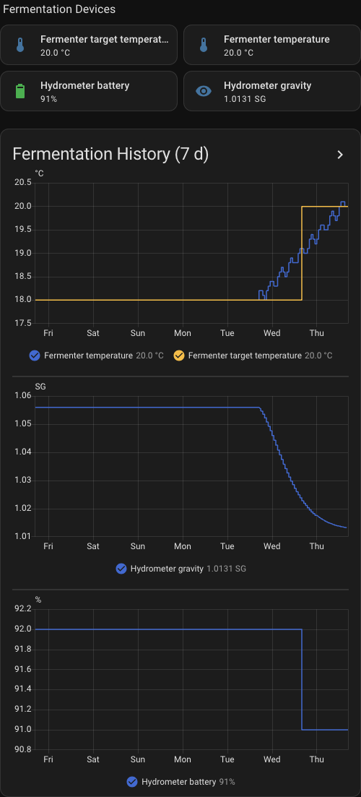
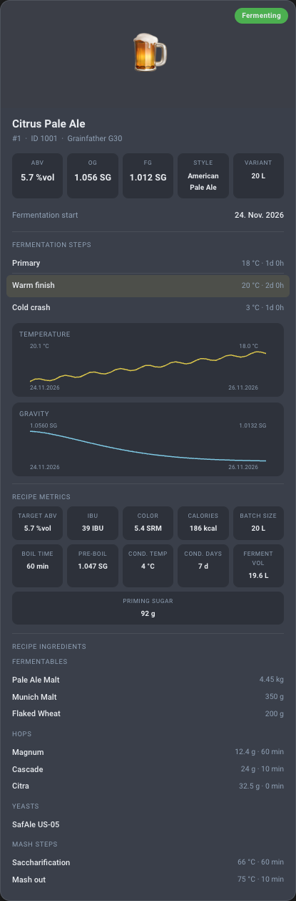
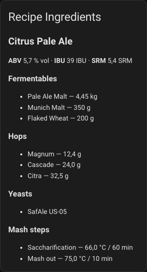

# Home Assistant Grainfather Integration

Connect Home Assistant to the Grainfather cloud to see brew sessions, fermentation devices, and recipe images, and control brew sessions.

## Support

If you find this integration useful, you can support its development:

- [Buy Me a Beer](https://buymeacoffee.com/abapblog)

## Features

- Sign in with your Grainfather email and password.
- See batch details, gravity, style, recipe images, and batch variants.
- Track target ABV, IBU, color (SRM), calories, batch size, and boil time for each session.
- Track pre-boil gravity, conditioning temperature and duration, fermentation volume, and priming sugar.
- Read fermentables, hops, yeasts, and mash steps from the session's recipe sensor.
- Read history and dates such as `condition_date`, `fermentation_start_date`, and `created_at` from brew session attributes.
- Monitor device temperature and gravity. Fermentation controllers also report their target temperature.
- Change brew session status and fermentation steps with service actions.
- Use button and select helpers for common brew session actions.
- Use local integration branding on Home Assistant `2026.3+`.

## Installation

### HACS

1. Open HACS.
2. Add this repository as a custom repository of type `Integration` if it is not already listed.
3. Install `Grainfather`.
4. Restart Home Assistant.
5. Go to Settings > Devices & Services > Add Integration.
6. Search for `Grainfather` and enter your Grainfather credentials.

### Manual

1. Copy [custom_components/grainfather](custom_components/grainfather) into your Home Assistant `custom_components` directory.
2. Restart Home Assistant.
3. Add the `Grainfather` integration from Settings > Devices & Services.

## Exposed Data

The integration polls the Grainfather cloud API at an interval that depends on
session and device activity. See [Adaptive Polling](#adaptive-polling). It provides:

- Brew sessions
- Fermentation devices
- Fermentation history linked to devices and sessions
- Recipe images

The integration uses these API endpoints, among others:

- `/api/auth/login`
- `/api/2/brew-sessions`
- `/api/equipment/fermentation-devices`

See [docs/api.md](docs/api.md) for the full Grainfather cloud API reference.

### Historic Fermentation Statistics

When the integration loads, it imports Grainfather history into Home Assistant
Recorder as hourly external statistics. Each reload can repair the import.
The import covers active and completed batches regardless of the
`include_completed_sessions` option.

Each batch with measurements can produce these statistic IDs:

- `grainfather:<entry_id>_batch_<batch_id>_temperature` (`°C`)
- `grainfather:<entry_id>_batch_<batch_id>_specific_gravity` (`SG`)
- `grainfather:<entry_id>_batch_<batch_id>_plato` (`°P`)

`<entry_id>` is Home Assistant's slugged config-entry ID and `<batch_id>` is
the Grainfather brew-session ID. Use **Developer Tools → Statistics** to find
the exact IDs. Recorder stores the hourly mean, minimum, and maximum for
temperature, specific gravity, and Plato. The import uses the same one-decimal
SG-to-Plato conversion as the live sensors.

The brew session's **Batch Number** entity identifies the batch. Only an active
fermentation has `status` set to `fermenting` and `is_current_batch` set to `true`.
`fermentation_devices` lists the devices currently linked to the batch.
`fermentation_device_ids` preserves the device IDs reported by the API.
History graphs use three fixed attributes on this entity: `temperature_statistic_id`,
`specific_gravity_statistic_id`, and `plato_statistic_id`.

Fermentation-device sensors show live hardware readings: temperature, gravity,
Plato, and controller target temperature when available. A device linked to a
fermenting session also has an **Active Charge** sensor. Its state is the session
or recipe name. `brew_session_unique_id` identifies the Batch Number entity.
`brew_session_entity_id` gives its Home Assistant entity ID when available.
The sensor does not copy batch data. Several sessions can ferment at the same
time, each with its own Batch Number entity.

Use a `statistics-graph` card to chart a completed fermentation:

```yaml
type: statistics-graph
title: Batch fermentation
chart_type: line
period: hour
entities:
  - "grainfather:<entry_id>_batch_<batch_id>_temperature"
  - "grainfather:<entry_id>_batch_<batch_id>_plato"
```

Replace the example statistic IDs with the values returned by the Statistics
developer tool.

### Adaptive Polling

The Grainfather cloud API is REST-only. The integration varies how often it polls:

- It uses the **active interval** (default 60 s) while a session is **brewing**
  or **fermenting**, or when a linked fermentation controller has reported recently.
- Otherwise, it uses the **idle interval** (`scan_interval`, default 300 s) to
  reduce load on the Grainfather cloud and Home Assistant.
- After a service call or a write to a number or select entity, it refreshes
  immediately. It briefly keeps the active interval to pick up changes on the device.

Both intervals have a range of 60 to 3600 s. Set them under
**Settings > Devices & Services > Grainfather > Configure** using *Idle update interval*
and *Active update interval*. Home Assistant updates the entities when each poll completes.

### Brew Session & Recipe Sensors

Home Assistant represents each brew session as a device. Its sensor IDs follow
`sensor.grainfather_<session>_<key>`, for example `sensor.grainfather_batch_01_ibu`.
Home Assistant generates `<session>` from the device name. Find the exact IDs
under **Settings > Devices & Services > Grainfather** or search for `grainfather`
under **Developer Tools > States**.

Recipe metric sensors:

| Sensor key | Meaning | Unit |
| --- | --- | --- |
| `target_abv` | Recipe target ABV | `%vol` |
| `ibu` | Bitterness | `IBU` |
| `color_srm` | Beer color | `SRM` |
| `calories` | Estimated calories | `kcal` |
| `batch_size` | Recipe batch size | litres |
| `boil_time` | Boil time | minutes |

Extra brew-session sensors:

| Sensor key | Meaning | Unit |
| --- | --- | --- |
| `pre_boil_gravity` | Pre-boil gravity | (gravity) |
| `conditioning_temperature` | Conditioning temperature | °C |
| `conditioning_duration` | Conditioning duration | days |
| `ferment_volume` | Fermentation volume | litres |
| `priming_sugar` | Priming sugar amount, with `priming_sugar_type` / `priming_sugar_amount` attributes | (amount) |

A sensor reports `unknown` if the session or recipe does not provide the field.
For example, `target_abv` needs recipe data and the `conditioning_*` sensors need
the corresponding fields from the session.

### Recipe Ingredients (attributes)

Each brew session has a `recipe_info` sensor (`sensor.grainfather_<session>_recipe_info`).
Its state is the recipe name. Its attributes include:

- `abv`, `ibu`, `srm`, `og`, `fg`
- `fermentables`, `hops`, `yeasts`, `mash_steps` (ingredient lists, up to 30 items each)

A standard card shows only the count or name. To show the lists, use a Markdown
card with a Jinja template, as shown below. Check the sensor in
**Developer Tools > States** for the fields Grainfather supplies, such as `name`
and `amount`.

### Fermentation Controller Target Temperature

For a fermentation controller (`fermentation_device_type_id == 30`), the
integration adds `sensor.grainfather_<device>_target_temperature` (°C) alongside
the controller's temperature and gravity sensors.

### Using the New Sensors

Show one brew session's metrics on an **Entities** card:

```yaml
type: entities
title: Batch 01 – Recipe & Metrics
entities:
  - sensor.grainfather_batch_01_target_abv
  - sensor.grainfather_batch_01_ibu
  - sensor.grainfather_batch_01_color_srm
  - sensor.grainfather_batch_01_calories
  - sensor.grainfather_batch_01_batch_size
  - sensor.grainfather_batch_01_boil_time
  - sensor.grainfather_batch_01_pre_boil_gravity
  - sensor.grainfather_batch_01_conditioning_temperature
  - sensor.grainfather_batch_01_conditioning_duration
  - sensor.grainfather_batch_01_ferment_volume
  - sensor.grainfather_batch_01_priming_sugar
```

Show a single metric as a **Gauge**:

```yaml
type: gauge
name: ABV
entity: sensor.grainfather_batch_01_target_abv
min: 0
max: 12
```

In a **Markdown** card, use `state_attr` to read the recipe ingredients:

```yaml
type: markdown
content: |
  ## {{ states('sensor.grainfather_batch_01_recipe_info') }}
  **ABV** {{ state_attr('sensor.grainfather_batch_01_recipe_info','abv') }} %
  **IBU** {{ state_attr('sensor.grainfather_batch_01_recipe_info','ibu') }}

  ### Hops
  
  - {{ h.name }} {{ h.amount if h.amount is defined else '' }}
  

  ### Fermentables
  
  - {{ f.name }}
  
```

Plot the controller target temperature next to its measured temperature with a
**history-graph**:

```yaml
type: history-graph
title: Fermentation Controller
hours_to_show: 48
entities:
  - sensor.grainfather_conical_temperature
  - sensor.grainfather_conical_target_temperature
```

Alert when the controller drifts away from its target temperature:

```yaml
alias: Fermentation temp drift alert
trigger:
  - platform: template
    value_template: >
      {{ (states('sensor.grainfather_conical_temperature') | float(0)
          - states('sensor.grainfather_conical_target_temperature') | float(0)) | abs > 1.5 }}
action:
  - service: notify.mobile_app_phone
    data:
      message: "Fermentation temp is off target!"
```

## Service Actions

The integration registers these service actions:

1. `grainfather.set_brew_session_status`
2. `grainfather.set_fermentation_steps`
3. `grainfather.set_fermentation_step_duration`
4. `grainfather.clear_fermentation_step_finish_temperature`
5. `grainfather.adjust_current_step_temperature`
6. `grainfather.adjust_current_step_duration`
7. `grainfather.advance_to_next_fermentation_step`

`grainfather.set_brew_session_status` accepts a `status` as either a numeric code or one of:

- `planning`
- `brewing`
- `fermenting`
- `conditioning`
- `serving`
- `completed`

## Branding

This repository includes local branding assets in [custom_components/grainfather/brand](custom_components/grainfather/brand).

- Home Assistant uses `icon.png` where space is limited.
- It uses `logo.png` where it can show a wider image.

Home Assistant only uses local custom integration branding from `brand/` starting with version `2026.3`.

## Development

- [custom_components/grainfather](custom_components/grainfather) contains the integration source
- [tests](tests) contains API, config-flow, Home Assistant runtime, coordinator, control, and history-importer tests
- [pyproject.toml](pyproject.toml) contains local tooling configuration
- [docs/api.md](docs/api.md) documents the Grainfather cloud API used by the integration

CI tests on Python 3.13. The `dev` extra pins `pytest-homeassistant-custom-component`
to the last release that supports Python 3.13. That release uses Home Assistant Core 2026.2.3.

## Lovelace Cards

The repository includes several custom JavaScript cards in [custom_components/grainfather/www](custom_components/grainfather/www).

The integration registers the cards automatically; no dashboard resource entry
is needed. After updating the integration, restart Home Assistant and reload
the dashboard. Changed card files get new URLs, so you don't need to clear
the browser cache.

### Brew Collection Card

`grainfather-brew-collection-card.js` shows multiple brew sessions in a grid.
Set a fixed number of cards per row or let the grid fit the available width.
Choose a card layout, filter or group sessions by status, and hide duplicates
with the options below.

**Example configuration:**

```yaml
type: custom:grainfather-brew-collection-card
title: Active Brews
entities:
  - sensor.grainfather_batch_01_batch_number
  - sensor.grainfather_batch_02_batch_number
  - sensor.grainfather_batch_03_batch_number
card_type: brew-session-detailed
statuses: [fermenting, conditioning, serving]
deduplicate: false
group_by_status: true
```

**Configuration Options:**

- `title` (string): Display name for the collection
- `entities` (list): Grainfather `batch_number` sensors to show
- `card_type` (string): Choose `brew-session-detailed` (V2) or `brew-session-compact` (V3).
- `statuses` (list): Statuses to show (default: all available). Options: `fermenting`, `conditioning`, `serving`, `brewing`, `planning`, `completed`.
- `deduplicate` (boolean): Show one card per `batch_number` and session name pair
- `group_by_status` (boolean): Group sessions by status in separate sections
- `cards_per_row` (number): Fixed number of cards per row (`0` = auto-fit mode)
- `card_min_width` (number): Minimum card width in px used by auto-fit mode

### Brew Session Cards (Detailed & Compact)

Both cards show one brew session. Set `density_unit: default|sg|plato|brix`.
Choose `default` to use the integration-wide setting.

- Detailed card (V2) reads ingredients from the recipe sensor on the same Home
  Assistant brew-session device, even if you rename the sensor. Fermentable
  amounts below `1 kg` or `1 lb` show `g` or `oz`, respectively, when positive.
  Other amounts retain the recipe's `kg` or `lb` unit.
  Hop amounts show `g` for metric recipes or `oz` for imperial recipes.
  The card lists fermentation steps and shows durations such as `1d 7h`.
  It highlights the current step only while the session is `fermenting`.
  While fermenting, it charts the displayed batch's hourly temperature and
  gravity history from Recorder. The gravity chart follows `density_unit`.
- Compact card (V3) provides a denser summary layout for large dashboards.
- Both cards display target ABV to one decimal place and IBU as a whole number
  without changing the underlying sensor values.

### Fermentation Device Card

`grainfather-fermentation-device-card.js` shows live device readings and controls
for the active brew session.

- The card shows changes to step temperature and duration immediately.
- It groups rapid adjustments before sending them.
- It sends absolute values to reduce conflicts between dashboards.
- Linked recipe name in the card title
- Optional fermentation steps list (`show_fermentation_steps`)
- Optional temperature, duration, and next-step control panel (`show_controls`)
- Temperature and gravity history graphs are on by default. Set `show_graphs: false`
  to hide them. The gravity graph uses the same `density_unit` as the live reading.
  You can override the integration default on the card.
- Current-step highlighting only when status is `fermenting`

The graphs use the fixed Recorder statistic IDs from the linked brew session's
Batch Number entity, rather than live sensor history. The graphs clear when you
unlink the device or the session stops fermenting.

### On Tap Blackboard Card

`grainfather-on-tap-card.js` shows beers with `status = serving` on a pub-style
blackboard. If a batch has more than one variant, the card shows only the first.

- Shows only the batch number, style, ABV, and original gravity.
- Supports `density_unit: default|sg|plato|brix`, as do both Brew Session cards.
- On narrow screens, ABV and gravity move to a second line so beer names stay visible.

```yaml
type: custom:grainfather-on-tap-card
max_items: 12
density_unit: sg
```

## Example Dashboard

[dashboard.yaml](dashboard.yaml) requires **Home Assistant 2026.11 or newer**
for its native [automatic section](https://www.home-assistant.io/dashboards/sections/#adding-an-automatic-section).
This requirement applies to the example, not the integration itself.

1. Set up the Grainfather integration and install
   [Auto Entities](https://github.com/thomasloven/lovelace-auto-entities) from
   **Settings > Marketplace** for the dynamic history and metrics cards. The
   example no longer requires Auto Sections Strategy or Device Card.
2. Create a Home Assistant label named **Grainfather Fermentation** and
   [apply it](https://www.home-assistant.io/docs/organizing/labels/#applying-labels)
   to the Grainfather fermentation hardware, not the brew-session devices.
   If you use a different label ID, set `target.label_id` in the **Active
   Fermentations** view to match. Label new hardware to include it in this view.
3. Create a dashboard under **Settings > Dashboards**. Open it, enter edit
   mode, and paste the example into the **Raw configuration editor**. Before
   saving, replace `sensor.grainfather_batch_01_recipe_info` with the recipe
   sensor you want the **Recipe Ingredients** card to show.
   The card rounds recipe figures and shows units without changing sensor values.

The **Brew Sessions** view discovers batches automatically, excludes completed
ones, and sorts the rest by batch number, newest first. To migrate an existing
dashboard, back up its raw configuration and replace the old Brew Sessions and
Active Fermentations views with the corresponding views from the example.

## Dashboard UI Overview

### Card Picker

Shows all custom Grainfather cards available in Lovelace.


### On Tap Blackboard

Shows serving and coming-soon beers using the blackboard layout.


### Brew Sessions With Compact Card

Shows active sessions with the compact brew session layout.


### Active Fermentations

The example dashboard shows native Home Assistant tiles for labeled fermentation
devices and seven days of history.



### Brew Session Detailed Card

The detailed batch card shows recipe metrics, ingredients, and fermentation
steps. Temperature and gravity charts appear only while the batch is fermenting.



### Recipe Ingredients

The **Recipe & Metrics** view shows rounded values and units in the recipe
ingredient list.



## Current Limitations

- Grainfather does not publish API documentation. Some assumptions about the
  payload come from observed responses.
- The REST API offers no WebSocket, MQTT, or webhook channel to third parties.
  The integration uses [adaptive polling](#adaptive-polling) (`cloud_polling`).

## Roadmap

1. Add tests that use captured API responses as fixtures.
2. Add entities as more Grainfather API fields and workflows are confirmed.
